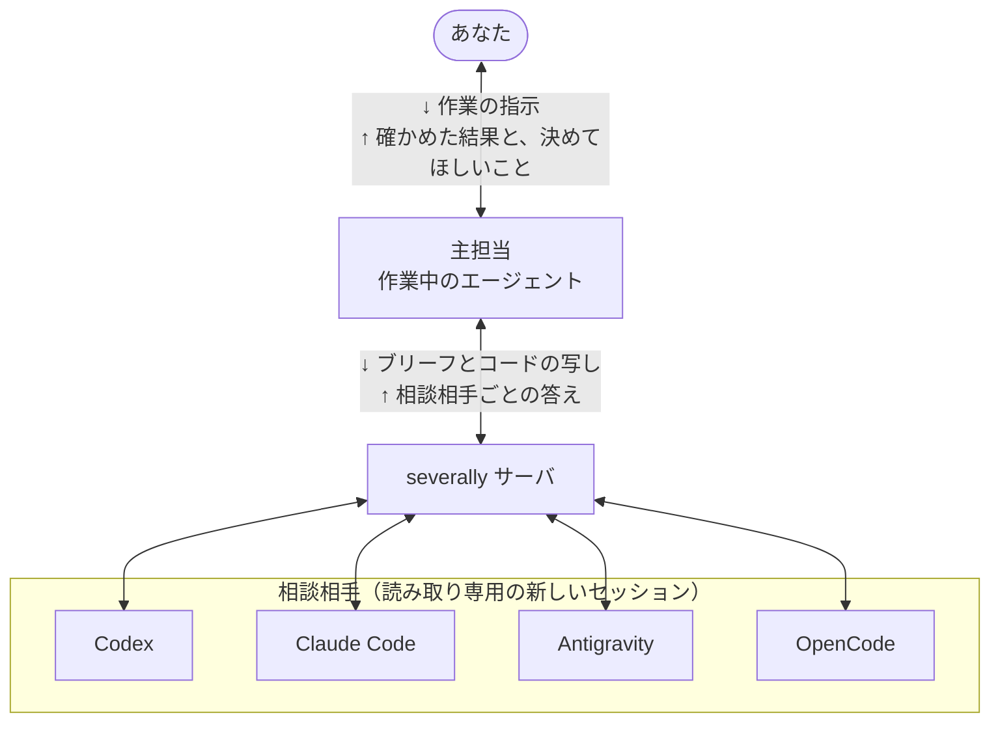

<h1 align="center">
  <picture>
    <source media="(prefers-color-scheme: dark)" srcset="assets/images/logo-dark.png">
    
  </picture>
</h1>

<p align="center">
  <a href="https://github.com/coz-a/severally/actions/workflows/test.yml"></a>
</p>

<p align="center"><a href="README.md">English</a> | 日本語</p>

AI エージェントが、ほかのコーディングエージェントに独立した意見を求め、答えを相談相手ごとに受け取るためのプラグインです。

相談相手は Codex・Claude Code・Antigravity・OpenCode です。エージェントは、調査に行き詰まったときや、甲乙つけがたい選択に当たったときに、相談相手に意見を
求めます。返ってきた指摘は自分で確かめ、その結果をもとに作業を続けます。巻き戻しにくい変更のような
重要な判断では、承認を求める前に相談し、あなたが決めるべきことだけを訊きます。あなたから
「Codex に聞いて」と頼むこともできます。

severally は、独立した複数の相談相手に質問し、答えを 1 つにまとめずに相談相手ごとに返します。意見が割れたこと
自体にも意味があるからです。エージェントは割れた理由を確かめたうえで、どう受け止めるかを決めます。

遅い商品ページを 5 分キャッシュしてよいかを聞くと、3 人の相談相手がそれぞれ次のように答えました（全体は
[使い方の例](docs/how-it-works.ja.md#使い方の例)にあります）。

```
codex        do_not_proceed  価格は会員のランクで変わるので、最初の訪問者の価格が全員に出る
claude-code  do_not_proceed  最初にキャッシュを埋めた人の価格が、5 分間ほかの全員に出る
antigravity  alternative     会員割引がほかの利用者に漏れる。クエリを直せばキャッシュは要らないかもしれない
```

## 目次

- [背景](#背景)
- [インストール](#インストール)
  - [必要なもの](#必要なもの)
  - [コマンドライン](#コマンドライン)
  - [更新](#更新)
  - [アンインストール](#アンインストール)
- [使い方](#使い方)
  - [頼み方](#頼み方)
  - [答えが返ったあと](#答えが返ったあと)
  - [モード](#モード)
  - [履歴と記録](#履歴と記録)
- [使い方の例](#使い方の例)
- [おすすめの構成](#おすすめの構成)
- [設定](#設定)
- [相談相手が読めるものとできること](#相談相手が読めるものとできること)
- [API](#api)
- [貢献](#貢献)
- [ライセンス](#ライセンス)

## 背景



主担当は、あなたといっしょに作業しているエージェントです。*ブリーフ*（質問と、その前提になる事実）を書き、関係する
コードの読み取り専用の写しを添えて相談します。答えが返ったら指摘を自分で確かめ、あなたが決めることだけを
訊きます。ふだんの相談で主担当がするのは、相談を始める、答えを待つ、確かめた指摘を 1 つ記録する、の 3 つです。

相談相手は、この質問のためだけに起動した、その CLI の新しいセッションです。サーバが送るのはブリーフと明示して公開したファイルで、あなたとの会話は引き継ぎません。
CLIによっては、そのほかのファイルも読めます。severally のサーバは、どの相談相手にも同じブリーフを送り、答えを相談相手ごとに返します。答えをまとめたり、どれが正しいかを判定したりはしません。

相談相手が何を読めて何ができるかは、[相談相手が読めるものとできること](#相談相手が読めるものとできること)に書いています。

## インストール

### 必要なもの

- Node.js 22 以降
- インストールしてログインした CLI（4 つのうち少なくとも 1 つ）。1 つで足り、Claude Code だけでも、新しい
  Claude Code のセッションに相談できます。

インストーラとサーバは Linux・macOS・Windows でテストしています。Claude Code と Codex のマーケットプレイスからの
導入と、実際の CLI での動作を試したのは Linux だけです。

macOS、Linux、Windows（PowerShell またはコマンドプロンプト）のどれでも、次の 1 行で入れられます。

```bash
npx -y severally-mcp@2.6.0 install
```

インストーラは、`PATH` で見つかった CLI のそれぞれに severally を登録します。末尾に `--dry-run` を付けると、何も
変えずに変更内容だけを表示します。

終わったら、クライアントを再起動してください。動いているセッションは、新しい登録を読み直しません。相談を始めずに
設定を確かめるには、次を実行します。

```bash
npx -y severally-mcp@2.6.0 status
```

設定ファイル・この機械から使える相談相手・入っている写しの版・どのクライアントに登録されているか・各 CLI に
ログインしているかを表示します。ログインの確認は CLI 自身の状態確認コマンドを読むだけで、プロンプトは送りません。
使用枠を使い切っていないかは確かめません。それは最初の相談で分かります。

Codex と Claude Code がある機械での出力の一部を示します。

```text
config: ok

consultants:
  codex: codex, <model>  available
  claude-code: claude-code, <model>  available

clients:
  Claude Code  registered (listed by the client)
  Codex        registered (listed by the client)

login (out of quota is not checked; the first consultation shows it):
  codex        logged in
  claude-code  logged in
```

通常は無設定で使えます。再起動したエージェントとのチャットに、次のように頼んでください。
Codexがなければ、`status` の `available` に出た相手の名前に置き換えます。

```text
Codexに聞いて。読み取り専用の公開APIに毎分100件のリクエストがあります。
更新の反映は60秒遅れてもよい場合、30秒間のキャッシュは妥当ですか？
```

返答の例です。実際の回答モデルと、確かめたこと・未検証のことは相談結果によって変わります。

```text
Codex（回答モデル: 結果に表示されたモデル）は、30秒のキャッシュを候補に挙げました。
30秒は許容する60秒以内です。ほかのキャッシュを重ねた場合の遅延は未検証なので、
その合計が60秒以内か確かめてから採用することを勧めます。
```

続けて「更新を5秒以内に反映する必要がある場合も、同じ相手に聞いて」と頼めます。
質問に前提を書けば、別の `context.facts` を用意する必要はありません。コードの相談には対象のファイルか差分を添えます。

名指しならその1人へ、相手を指定しないセカンドオピニオンと「全員に聞いて」は設定済みの全員へ送ります。
全員への相談は、相手の人数分の利用枠を使います。

マーケットプレイスやクローンからの導入、グローバルインストールができないときの動作は
[インストールの詳細](docs/install.ja.md)にあります。

### コマンドライン

`--dry-run`、`--manual`、`--force` などの使い方は
[インストールのオプション](docs/install.ja.md#コマンドライン)にあります。

### 更新

次の 1 行で、最新版に入れ替わります。バージョン番号を調べる必要はありません。

```bash
npx -y severally-mcp@latest install
```

`@latest` を付けると、npx は毎回 npm に最新版を問い合わせます。手元に古い写しがあっても、それは使いません。
Claude Code にマーケットプレイス版の severally が入っていれば、同じ 1 行でその写しも更新されます（詳しくは
[docs/install.ja.md](docs/install.ja.md#更新)）。終わったら、クライアントを再起動してください。版ごとの変更点は
[リリース](https://github.com/coz-a/severally/releases)にあります。

### アンインストール

マーケットプレイスから入れた場合は、Claude Code で `/plugin marketplace remove severally` を実行します。プラグインも
一緒に取り除かれます。インストーラで入れた場合のコマンドは、OS とインストール方式ごとに
[docs/install.ja.md](docs/install.ja.md#アンインストール) にあります。どの場合も、履歴とバックアップは `~/.severally/` に
残るので、要らなければ消してください。

## 使い方

### 頼み方

エージェントとのチャットで、ふだんの言葉で頼みます。

```
> この移行計画が安全か Codex に聞いて
> このキャッシュの設計にセカンドオピニオンをもらって
> マージする前にみんなに聞いて
```

- 相談相手を名指しすると（「Codex に聞いて」「Claude Opus に聞いて」）、その相手だけに聞きます。CLI の名前でも、
  モデルの名前でも呼べます。
- 名指しせずにセカンドオピニオンを頼むか、全員に聞くよう頼むと、すべての相談相手に同じブリーフを送ります。
  自分の CLI の新しいセッションも含みます。使用量は、相談相手 1 人につき 1 回分です。
- 頼まなくても、エージェントは自分から相談します。調査が行き詰まったとき、甲乙つけがたい選択に当たったとき、
  巻き戻しにくい変更の承認を求める前です。

あなたに返ってくるのは、相談相手の答えそのものではなく、主担当の報告です。確かめたことと結果、勧めること、
まだ確かめていないことが並びます。報告の例は[使い方の例](#使い方の例)にあります。

相談が向いているのは、重要な設計判断、巻き戻しにくい選択、同じ不具合で 2 回以上失敗したときです。相談 1 回に
数分から 10 分ほどと実際の使用量がかかるので、小さな修正には向きません。

### 答えが返ったあと

相談を始めても、エージェントは答えを待たずに、答えに左右されない作業を進められます。答えはふつう 1〜10 分で
そろいます（いちばん時間がかかるのは Antigravity です）。

どの答えにも同じ形を求めます。結論、根拠つきの指摘、決められなかったこと、判断が変わる条件、確かめ方です。
結論や指摘の根拠などが欠けた答えは、そのことを注意書き（caveat）で知らせます。
相談相手が失敗したときは、理由（`usage_limit`、`timeout` など）を付けて失敗として返します。「問題なし」として
返すことはありません。

エージェントは、判断を変え得る指摘を自分で確かめます。そのうえで、何を確かめたか、何を採らなかったか、まだ何を
確かめていないかを伝えます。

### モード

モードは 3 つあり、エージェントが渡した中身から決まります。「Codex とこれを討論して」のように、あなたが指定する
こともできます。

- `explore`：計画を見せずに聞く。相談相手は、まず自分のやり方で答える
- `review`：計画を見せて、どこがまずいかを聞く（[使い方の例](#使い方の例)はこれ）
- `debate`：計画と反対の主張を見せて、比べてもらう

最初の答えのあと、同じ相談相手に追加の質問を送れます。既定では 4 回まで、合わせて 5 往復です。全員に聞いた相談に追加の質問を送ると、全員にもう一度聞けます。それぞれの相談相手とのやりとりは別々に続きます。

### 履歴と記録

相談の記録は、あなたのマシンの `~/.severally/history/` に残ります。送ったブリーフ、相談相手の答え、指摘ごとの
エージェントの判定（`confirmed`、`not_applicable`、`unverifiable`、`unverified`）が入っています。判定は、あとから
別のセッションで足せます。相談は、Markdown としてリポジトリに書き出せます。

相談相手の呼び方、相談の進み方、記録の詳細は [docs/how-it-works.ja.md](docs/how-it-works.ja.md) にあります。

## 使い方の例

商品ページの応答を5分間キャッシュする案を、3人の相手に聞いた例を
[仕組みの文書](docs/how-it-works.ja.md#使い方の例)に載せています。相手別の判断と、主担当が指摘を検証して採否を決める流れを追えます。
検証結果は指摘の隣に残り、Markdownとして書き出せます。

## おすすめの構成

通常は無設定で使えます。普段の作業と相談でモデルを分けたい場合は、
[複数モデルの設定例](docs/how-it-works.ja.md#おすすめの構成)を参照してください。導入には必要ありません。

## 設定

**既定のままなら設定は要りません**。サーバは起動時に `PATH` にある CLI を探し、見つかった CLI をそれぞれ、既定の
モデルで動く相談相手にします。CLI を止める、ほかのモデルの相談相手を足す、といったときは
`~/.severally/config.json` を置きます。クローンから入れた場合は、`npm run init-config` でひな形を作れます。キーは
すべて [CONFIG.md](CONFIG.md)（英語）にあり、[config.example.json](config.example.json) は書き換えて使う例です（パス・モデル・メモは架空のものです）。
設定を変えたら、クライアントを再起動してください。

API キーで呼び出すモデル（OpenRouter や、OpenAI 互換のほかの API）やローカルのモデルに相談するには、OpenCode を入れて、
そのモデルを相談相手に足します。書き方は
[CONFIG.md](CONFIG.md#api-keys-and-other-model-families-through-opencode) にあります。

## 相談相手が読めるものとできること

相談では、ブリーフをその CLI のモデルに送ります。あなたが自分でその CLI を使うときと同じです。あなたの会話の履歴は
送りません。どの相談相手も、次のことはできません。

- ファイルを書く
- MCP を使う
- ほかのエージェントを起動する、ほかの誰かに相談する
- Web 検索と閲覧のほかにネットワークを使う

| 相談相手 | ファイルの読み取り | 秘密のパス | シェル | 書き込み | Web 検索・閲覧 |
|---|---|---|---|---|---|
| Codex | できる | パスで拒否（権限プロファイル）。`.env` のようなファイル名では拒否しない | ある。サンドボックスの中（コマンドは動くが、書き込みとネットワークはできない） | できない | できる（`network: "off"` のときを除く） |
| Claude Code | できる（`Read` / `Glob` / `Grep`） | 拒否（権限の規則） | なし | できない | できる（`network: "off"` のときを除く） |
| Antigravity | できる（`view_file`・`read_file`） | 拒否（ツールのフック） | なし | できない | できる（`network: "off"` のときを除く） |
| OpenCode | できる（`read` / `glob` / `grep`） | 拒否（権限の規則） | なし（Code Mode の `execute` は拒否） | できない | できる（`network: "off"` のときを除く） |

どの相談相手も、渡したファイルの写しだけが入った専用の作業ディレクトリで始まり、サーバはあなたのリポジトリの
場所を伝えません。それでも、あなたのユーザーアカウントで読めるファイルは、表で「拒否」とした秘密のパスを除いて
読めます。例外は、ファイルを渡した相談での Claude Code です。そのときは、渡したファイルの写ししか読めません。
Codex はファイルの名前では拒否しないので、あなたのリポジトリにある `.env` は Codex から読めます。

**ディスクを読めて Web も閲覧できる相談相手は、読んだ内容を URL に載せて外に持ち出せます**。開いたページに、
そうするよう書かれていた場合などです。それを防ぎたいときは、エージェントが `network: "off"` を渡します。その回の
どの相談相手も、Web の検索と閲覧ができなくなります。すべての相談でそうするには、
[設定ファイル](CONFIG.md#server-wide-keys)に `"server": { "network": "off" }` と書きます。依頼の側からは戻せません。それでも、ブリーフと相談相手が読んだ内容は、その CLI の
モデルに送られます。

CLI ごとにどう守らせているかは [docs/how-it-works.ja.md](docs/how-it-works.ja.md#相談相手を読み取りだけにとどめる仕組み) にあります。

## API

サーバの MCP ツールは 6 つです。あなたのマシンの外に何かを送るのは `consult_start` だけで、ブリーフと、相談相手に見せるファイルを
各相談相手のモデルに送ります。引数はすべて、エージェントが読むツールの説明に書いてあります。

| ツール | すること |
|---|---|
| `consult_start` | 1 人（`target`）または複数（`targets`）の相談相手に相談を始め、`job_id` か `group_id` をすぐに返す |
| `consult_get` | 相談を待ち、状態か答えを返す。`ids` を付けると、答えのうちその指摘だけを返す |
| `consult_cancel` | 相談、または全員に聞いた相談をまとめて止め、相談相手のプロセスも止める。別のセッションが始めた相談も止められる |
| `consult_record` | 答えの指摘ごとの主担当の判定と、答えから新しく分かったことを書く |
| `consult_list` | 前のセッションのものも含めて最近の相談を並べる。使用量は、このセッションで各相談相手が報告した分 |
| `consult_export` | 相談を、追加の質問と判定を含めて Markdown で返す |

引数とファイル公開の詳細は[仕組みの文書](docs/how-it-works.ja.md#apiの引数)にあります。

## 貢献

質問と不具合の報告は [Issues](https://github.com/coz-a/severally/issues) へどうぞ。プルリクエストも歓迎します。
大きな変更は、先に Issue で相談してください。参加する方は、[行動規範](CODE_OF_CONDUCT.md)に従ってください。

- `npm install` のあと `npm test` を実行します。テストは本物の代わりに用意した CLI を相手にオフラインで動き、
  実際の API は呼びません。
- CI では `npm run lint`・`npm run typecheck`・`npm run format:check` も確かめています。プルリクエストを出す前に
  実行してください。
- ソースか Skill のテンプレートを変えたら、`npm run build` を実行してください。ビルド済みのサーバ
  （`plugins/severally/dist/`）と生成した Skill はコミットしてあり、古いままだと CI が失敗します。
- `npm run live-check` と `npm run doctor` は、入っている CLI を相手に本物の相談を実行するので、実際の使用量がかかります。

## ライセンス

[Apache-2.0](LICENSE) © 2026 coz.a
