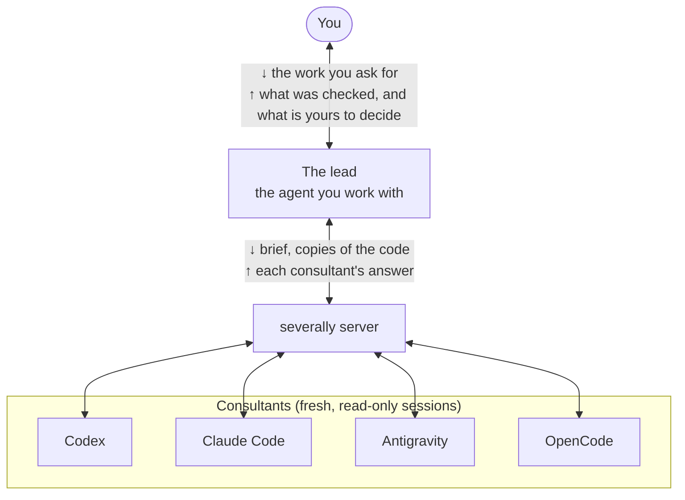

<h1 align="center">
  <picture>
    <source media="(prefers-color-scheme: dark)" srcset="assets/images/logo-dark.png">
    
  </picture>
</h1>

<p align="center">
  <a href="https://github.com/coz-a/severally/actions/workflows/test.yml"></a>
</p>

<p align="center">English | <a href="README.ja.md">日本語</a></p>

A plugin that lets your AI agent ask other coding agents for independent opinions, returned separately.

The consultants are Codex, Claude Code, Antigravity and OpenCode. When the agent gets stuck in an investigation, or faces two options that look equally good, it asks the
consultants for their opinions. It checks the findings that come back itself, and carries on from what it found.
For an important decision, such as a change that is hard to reverse, it consults before asking you to approve it,
and asks you only about what is yours to decide. You can also ask yourself: "ask Codex".

The plugin puts the question to several independent consultants, and returns each one's answer on its own
instead of merging them into one, because a disagreement means something too. The agent checks why they disagree
before deciding how to take the answers.

Asked whether to cache a slow product page for five minutes, three consultants answered on their own
(see [Example](#example) for the whole run):

```
codex        do_not_proceed  the price depends on the member's tier, so the first visitor's price is served to everyone
claude-code  do_not_proceed  whoever fills the cache first sets the price everyone else sees for 5 minutes
antigravity  alternative     member discounts leak to other users; fix the query and a cache may not be needed
```

## Contents

- [Background](#background)
- [Install](#install)
  - [Requirements](#requirements)
  - [Command line](#command-line)
  - [Updating](#updating)
  - [Uninstall](#uninstall)
- [Usage](#usage)
  - [Asking](#asking)
  - [When the answers come back](#when-the-answers-come-back)
  - [Modes](#modes)
  - [History and records](#history-and-records)
- [Example](#example)
- [Recommended setup](#recommended-setup)
- [Configuration](#configuration)
- [What a consultant can see and do](#what-a-consultant-can-see-and-do)
- [API](#api)
- [Contributing](#contributing)
- [License](#license)

## Background



The lead is the agent you are working with. It writes the *brief*, the question and the facts it rests on, and
consults with read-only copies of the code the question is about. When the answers come back, it checks the
findings itself and asks you only what is yours to decide. In a routine consultation the lead does three things:
starts it, waits for the answers, and records the one finding it checked.

Each consultant is a new session of its CLI, started just for this question. It sees the brief and the files it
was handed, and nothing of your conversation. The severally server sends every consultant the same brief and
returns the answers consultant by consultant. It does not merge them or judge which is right.

What a consultant can read and do is under [What a consultant can see and do](#what-a-consultant-can-see-and-do).

## Install

### Requirements

- Node.js 22 or newer
- At least one of the four CLIs, installed and logged in. One is enough: with only Claude Code, you can still ask a
  fresh Claude Code session.
- On macOS and Linux, npm's global executable directory on `PATH`: the default install puts a `severally-mcp`
  command there for Codex to launch. `--manual` does without it.

The installer and the server are tested on Linux, macOS and Windows; the Claude Code and Codex marketplace
routes and the real CLIs have been tried on Linux only.

One line, on macOS, Linux and Windows (PowerShell or Command Prompt):

```bash
npx -y severally-mcp@2.1.0 install
```

The installer registers severally with each CLI it finds on `PATH`. Add `--dry-run` at the end to print what it
would change without changing anything. Then restart the clients: a running session does not reload the new
registration.

Installing from the Claude Code plugin marketplace or from a clone, checking the registration, and what the
installer changes are in [docs/install.md](docs/install.md).

### Command line

```bash
npx -y severally-mcp@latest install [--dry-run] [--manual] [--force] [--skip-global]
```

| Option | What it does |
|---|---|
| `--dry-run` | prints what it would change, and changes nothing |
| `--manual` | registers the MCP server and copies the Skill instead of installing the plugin (the default on Windows) |
| `--force` | registers again where severally is already registered, instead of leaving it as it is |
| `--skip-global` | skips the global npm install in plugin mode, when `severally-mcp` on `PATH` is already this install |

What each mode changes is in [docs/install.md](docs/install.md#two-install-modes).

### Updating

This line replaces your install with the latest version, with no version number to look up:

```bash
npx -y severally-mcp@latest install
```

With `@latest`, npx asks npm for the newest version every time, so an older copy it already has is not used.
Then restart the clients. Installed from the Claude Code plugin marketplace: see
[docs/install.md](docs/install.md#updating). What changed in each version is in the
[releases](https://github.com/coz-a/severally/releases).

### Uninstall

Installed from the marketplace: run `/plugin marketplace remove severally` in Claude Code, which also removes the
plugin. For an installer install, the commands for each OS and install mode are in
[docs/install.md](docs/install.md#uninstall). Either way, history and backups stay in `~/.severally/`; delete it
if you no longer need them.

## Usage

### Asking

Ask in your own words, in the chat with your agent:

```
> ask Codex whether this migration plan is safe
> get a second opinion on this cache design
> ask everyone before we merge this
```

- Name a consultant ("ask Codex", "ask Claude Opus") and only that one is asked. A CLI's name works, and so
  does a model's.
- Ask for a second opinion without naming anyone, or ask everyone, and the same brief goes to every
  consultant, a fresh session of your own CLI included. That is one consultation's quota per consultant.
- The agent also consults without being asked: when an investigation stalls, when two options look equally
  good, and before asking you to approve a hard-to-reverse change.

What comes back to you is the lead's report, not the consultants' answers as they arrived: what it checked and
what that showed, what it recommends, and what is still unverified. The [example](#example) shows one.

It is worth it for important design decisions, hard-to-reverse choices, and two or more failed attempts at the
same bug. One consultation takes minutes and real quota, so it is not for small fixes.

### When the answers come back

Starting a consultation does not make the agent wait: it can work on something that does not depend on the
answers, which usually arrive within one to ten minutes (Antigravity is the slowest).

Every answer is asked for in the same shape: a bottom line, findings with their grounds, what the consultant could
not determine, conditions that would change its judgement, and how to check. When an answer leaves part of that
out, such as the bottom line or the grounds for a finding, it says so in a caveat. A consultant that fails comes
back as a failure with the reason (`usage_limit`, `timeout` …), never as "no problems found".

The agent checks the findings that would change the decision itself, then tells you what it checked, what it did
not adopt, and what is still unverified.

### Modes

There are three modes, chosen from what the agent hands over. You can also ask for one ("debate this with
Codex").

- `explore`: asks without showing the plan, so the consultant answers with its own approach first
- `review`: shows the plan and asks what is wrong with it (the [example](#example))
- `debate`: shows the plan with the opposing claims, and asks the consultant to weigh them

After the first answer, the agent can send follow-ups to the same consultant: up to four by default, five rounds
in total. A follow-up to a fan-out asks every consultant in it again, each continuing its own exchange.

### History and records

Every consultation is kept on your machine in `~/.severally/history/`: the brief that was sent, the consultant's
answer, and the agent's verdict on each finding (`confirmed`, `not_applicable`, `unverifiable`, `unverified`).
Verdicts can be added later, from another session. A consultation can be exported as Markdown into your
repository.

How to name consultants, how a consultation runs, and the records in detail are in
[docs/how-it-works.md](docs/how-it-works.md).

## Example

Here is how severally changes the way the agent works, shown in one situation: the agent comes up with a change,
and before asking you to approve it, it asks the consultants for their opinions.

The example is a small online shop's API. `GET /products/:id`, which serves the product page, is slow: about
800 ms. The API loads each product joined with its inventory and its reviews. Prices depend on the member's tier,
and gold members get a 10% discount.

The agent, running in Claude Code, comes up with a common fix: "keep each response in an in-memory Map for 5
minutes". Before asking you "can I go ahead?", it shows the plan to three consultants: Codex, Antigravity, and a
fresh Claude Code session (a new session of the agent's own CLI, with none of its conversation). Along with the
plan, it hands them read-only copies of the code involved. The answers come back one per consultant, side by side
(excerpt from a real run against a sample API):

```
codex        do_not_proceed  the price depends on the member's tier, so keyed by product id alone, the first
                             visitor's price is served to everyone; the join inflates stock; 4 workers keep
                             separate copies, so an order that changes stock does not clear the old value
claude-code  do_not_proceed  whoever fills the cache first sets the price everyone else sees for 5 minutes;
                             4 workers each keep their own copy, so stock stays stale after orders; fix the
                             join bug first too
antigravity  alternative     member discounts leak to other users; the 800 ms comes from joining inventory
                             and reviews, which also skews stock; rewrite the query and it is likely fast
                             enough without a cache
```

Each answer opens with a bottom line: `proceed`, `do_not_proceed`, `alternative` (do something else instead) or
`undetermined`. The three found the same problems, each on its own: the price leak, the inflated stock and the
per-worker caches. Where they differ is what comes next. Codex and Claude Code recommend fixing the query and
then caching only the part that does not depend on the user. Antigravity says that with the query fixed, a cache
may not be needed at all. Merge the answers into one and that difference gets buried.

The agent that asked (the *lead*) reads the findings and then checks them in its own repository. Of the two
findings, one reproduced exactly; the other turned out not to be happening yet, and that changed the response.

```
finding   the query joins inventory and reviews together, so stock is multiplied by the number of reviews
  checked   ran the query on a test database: 5 units in stock, 4 reviews -> stock comes out as 20
  so        fix the query before any cache

finding   a gold member's 10% discount would be served to guests
  checked   login is not wired in yet, so today everyone gets the base price.
            the leak starts the day login is added
  so        cache only the product data that does not depend on the user, and compute the price on each request
```

What comes back to you is not a vote of "2 against, 1 alternative". It is what was checked, what the lead
recommends, and what has not been checked yet. Here that is whether the fixed query is fast enough without a
cache (it needs production-like data), and how stale the stock shown after an order may be (that one is yours to
decide). You make the call. The checked results stay next to the findings and can be exported as Markdown into
your repository (see [History and records](#history-and-records)).

## Recommended setup

Register the strongest model of each vendor as a consultant, and do the everyday work on a cheaper model, such as
Sonnet in Claude Code. Most of the work, such as editing code, running tests and searching, goes fine on the
cheaper model. For the decisions where a wrong call costs the most, such as a design choice or a change that is
hard to reverse, the lead asks the strongest models, each on its own. They spend quota only in those
consultations, so most of the usage stays on the cheaper model, and the decisions that matter still get the
strongest models' opinions.

A `~/.severally/config.json` for this:

```json
{
  "consultants": {
    "opus": { "cli": "claude-code", "model": "claude-opus-5-5" },
    "gpt": { "cli": "codex", "model": "gpt-6.1-sol" },
    "gemini": { "cli": "antigravity", "model": "gemini-4-argon-high" }
  }
}
```

Model ids change as new models come out; replace them with the ones your CLIs offer. Consultants run at effort
`high` unless you set `effort`, except on Antigravity, where the model name sets it (`gemini-4-argon-high`) and an
`effort` key is a config mistake.

Then start the lead on the cheaper model (`claude --model sonnet`, or `/model sonnet` in a running session). The
lead consults on its own at the moments listed under [Asking](#asking), and you can ask it to ("ask everyone before
we merge this"). Each consultant runs on its own CLI's login and quota.

## Configuration

**No configuration needed by default.** At startup the server looks for the CLIs on `PATH`, and each one it finds
becomes a consultant on its default model. To turn a CLI off or add consultants on other models, put a
`~/.severally/config.json` in place. From a clone, `npm run init-config` writes a template. Every key is in
[CONFIG.md](CONFIG.md), and [config.example.json](config.example.json) is an example to adapt: its paths, models and notes are made up. Restart
the client after changing it.

To consult a model you reach with an API key (OpenRouter, or another OpenAI-compatible API) or a local model,
install OpenCode and add the model as a consultant: see
[CONFIG.md](CONFIG.md#api-keys-and-other-model-families-through-opencode).

## What a consultant can see and do

A consultation sends the brief to that CLI's model, the same way using the CLI yourself does. Your conversation
history is never sent. No consultant can:

- write files
- use MCP
- start other agents or consult anyone else
- use the network, except for web search and browsing

| Consultant | Reads files | Credential paths | Shell | Writes | Web search / browsing |
|---|---|---|---|---|---|
| Codex | yes | blocked by path (permission profile), not by file name such as `.env` | yes, in its sandbox (commands run, but cannot write or reach the network) | no | yes, unless `network: "off"` |
| Claude Code | yes (`Read` / `Glob` / `Grep`) | blocked (permission rules) | none | no | yes, unless `network: "off"` |
| Antigravity | yes (`view_file`) | blocked (tool hook) | none | no | yes, unless `network: "off"` |
| OpenCode | yes (`read` / `glob` / `grep`) | blocked (permission rules) | none (its Code Mode `execute` is refused) | no | yes, unless `network: "off"` |

Every consultant starts in a working directory of its own that holds only copies of the files you handed it, and
the server does not tell it where your repository is. It can still read any file your user account can read, except the credential paths the table marks blocked.
Codex does not block by file name, so a `.env` in your repository is readable to it.

**A consultant that can both read your disk and browse could carry what it read out in a URL**, for example if a
page it opens tells it to. To prevent that, the agent passes `network: "off"`: every consultant in that round then
has no web search or browsing. The brief, and whatever a consultant reads, still goes to that CLI's model.

How each CLI is held to this is in [docs/how-it-works.md](docs/how-it-works.md#how-a-consultant-is-kept-to-reading).

## API

The server has six MCP tools. Only `consult_start` sends anything off your machine: the brief, and the files
it exposes, go to each consultant's model. Every argument is described in the tool descriptions the agent reads.

| Tool | What it does |
|---|---|
| `consult_start` | Starts a consultation with one consultant (`target`) or several (`targets`), and returns a `job_id` or `group_id` at once |
| `consult_get` | Waits for a consultation and returns its state or answer; with `ids`, just those points of the answer |
| `consult_cancel` | Stops a consultation or a whole fan-out, and its consultant processes |
| `consult_record` | Writes the lead's verdicts on an answer's points, and what the answer added |
| `consult_list` | Lists this session's recent consultations, with the usage each consultant reported |
| `consult_export` | Returns a consultation, follow-ups and verdicts included, as Markdown |

The arguments of `consult_start` that matter most:

- `context.expose_paths`: files and directories, by absolute path, copied read-only for the consultant; a
  directory in a git repository copies only the files git lists (nothing `.gitignore` excludes)
- `context.expose_diff`: `{ repo, base? }`, a change in progress: the diff goes in the brief and the files it touches are copied
- `network`: `"off"` takes web search and browsing away from every consultant in the round
- `followup_to`: the `job_id` of the answer a follow-up continues, or a fan-out's `group_id` to ask every consultant in it again. A follow-up needs only this and `question`; the consultant, the mode and the earlier round's context carry over unless you pass them again

## Contributing

Questions and bug reports go to [Issues](https://github.com/coz-a/severally/issues). Pull requests are welcome; for
a large change, open an issue first so we can talk it over. Everyone taking part is expected to follow the
[Code of Conduct](CODE_OF_CONDUCT.md).

- `npm install`, then `npm test`. The tests run offline against stand-in CLIs and make no real API calls.
- After changing the source or the Skill template, run `npm run build`. The built server in
  `plugins/severally/dist/` and the generated Skills are committed, and CI fails when they are out of date.
- `npm run live-check` and `npm run doctor` run real consultations against the CLIs you have installed, and spend
  real quota.

## License

[Apache-2.0](LICENSE) © 2026 coz.a
