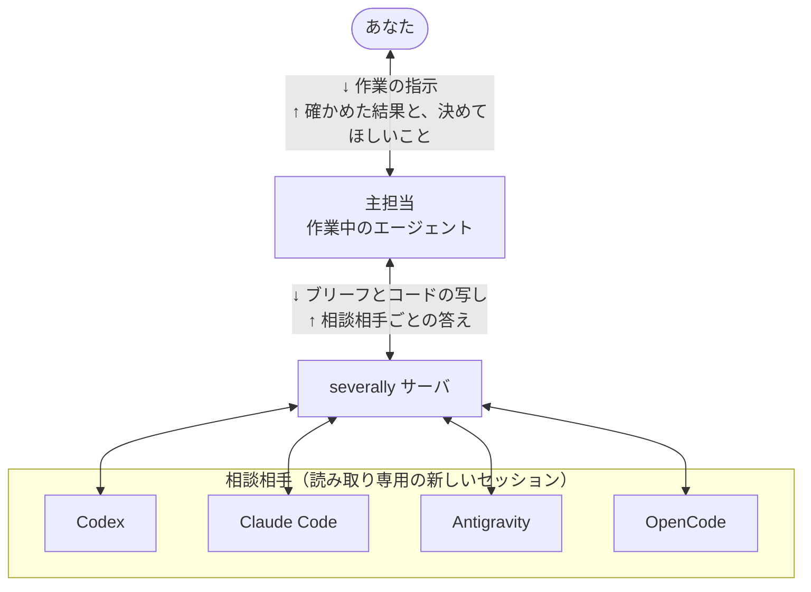

# severally の仕組みの詳細

<p><a href="how-it-works.md">English</a> | 日本語</p>

[README](../README.ja.md) に入れていない、相談の進み方の詳細です。どのクライアントから誰に相談するか、相談相手の呼び方、相談の進み方、記録、全員に聞いた相談の答えの
大きさ、相談相手を読み取りだけにとどめる仕組みを書きます。設定のキーはすべて [CONFIG.md](../CONFIG.md) にあります。

## どのクライアントから誰に相談するか



主担当は、あなたといっしょに作業しているエージェントです。*ブリーフ*（質問と、その前提になる事実）を書き、関係する
コードの読み取り専用の写しを添えて相談します。答えが返ったら指摘を自分で確かめ、あなたが決めることだけを
訊きます。ふだんの相談で主担当がするのは、相談を始める、答えを待つ、確かめた指摘を 1 つ記録する、の 3 つです。

相談相手は、この質問のためだけに起動した、その CLI の新しいセッションです。サーバが送るのはブリーフと明示して公開したファイルで、あなたとの会話は引き継ぎません。
CLIによっては、そのほかのファイルも読めます。severally のサーバは、どの相談相手にも同じブリーフを送り、答えを相談相手ごとに返します。答えをまとめたり、どれが正しいかを判定したりはしません。

相談相手が何を読めて何ができるかは、[相談相手が読めるものとできること](../README.ja.md#相談相手が読めるものとできること)に書いています。


どのクライアントから使っても、ほかの 3 つの CLI と、自分の CLI の新しいセッションに相談できます。サーバが起動する
コマンドは次のとおりです。同時に動かせる相談相手は、既定では、すべてのセッションを合わせて 9 人までです。

```
Claude Code ──(skill)──> severally server ──> codex exec | agy | opencode run | claude -p  (fresh session)
Codex       ──(skill)──> severally server ──> claude -p  | agy | opencode run | codex exec (fresh session)
Antigravity ──(skill)──> severally server ──> codex exec | claude -p | opencode run | agy  (fresh session)
OpenCode    ──(skill)──> severally server ──> codex exec | claude -p | agy | opencode run (fresh session)
```


## 相談相手の呼び方

- 相談相手は 1 つの CLI と 1 つのモデルの組なので、CLI の名前（「Codex に聞いて」「Gemini に聞いて」）でも、モデルの名前
  （「Claude Opus に聞いて」「DeepSeek に聞いて」）でも呼べます。
- 運用者が設定すれば、OpenCode で動く GLM と DeepSeek のように、1 つの CLI に相談相手を何人でも置けます
  （[CONFIG.md](../CONFIG.md) を参照）。OpenCode を通せば、OpenAI 互換のサーバ（ollama、LM Studio、vLLM）で動くローカルの
  モデルや、OpenRouter のモデル（Qwen と Kimi で確かめた）も相談相手にできます。
- 名前が 2 人以上に当てはまるときは、上位のモデルか、新しいバージョンのモデルに聞きます。決められなければ、
  主担当がどの相談相手のことかをあなたに尋ねます。
- 全員に聞くときの使用量は相談相手 1 人につき 1 回分で、既定の設定（CLI ごとに 1 人）なら 4 人分です。質問が小さければ、
  主担当が人数を減らすこともあります。
- 自分の CLI からの答えには、どのモデルが答えた場合でも「同じ系統（same lineage）」の注記が付くので、ほかのベンダーの
  答えと見分けられます。

## 相談の進み方

前提を含む `question` だけで、一般的な `explore` の相談を始められます。`context.facts` は任意で、質問の前提を重ねて書く必要はありません。
コードの相談にはファイルか差分を添えます。`review` の計画、`debate` の計画と反対意見は引き続き必要です。

- 相談を始めても、主担当は相談している計画そのものは進めません。
- 一時的な失敗（`rate_limited`、`cli_error`）は、少し待ってから、同じ時間の枠の中で、同じ相談相手とモデルで最大 2 回
  やり直します。それまでの失敗は `retries` に残ります。
- 相談相手のモデルがアカウントの使用枠を使い切ったとき（`usage_limit`）は、設定に `fallback_model` があれば、その
  モデルで 1 回だけやり直します。答えには代わりのモデルが答えたことが書かれ、`model` には実際に答えたモデルが入ります。
- 時間切れになったときは、相談相手がそこまでに書いていた内容の末尾を、途中までのものという印を付けて失敗の隣に
  残します。これは読む材料として残すもので、答えとしては扱いません。
- 相談の結果は、サーバを再起動したあとも、同じマシンで動くほかの severally のプロセスからも読めます。ほかのプロセスで
  実行中のものは実行中と返ります。終わる前にサーバがクラッシュや強制終了で止まったものは `interrupted` として返ります。
  サーバがふつうに終了したときは、実行中の相談を取り消しとして記録します。
- ほかの severally のプロセスから `consult_cancel` を呼ぶと、相談を実行しているプロセスへの取り消しの依頼を
  残します。実行しているプロセスは 1 秒ごとにそれを確かめ、相談を止めます。
- 主担当が自分では実行できない確認（ほかの人の答えが要るものなど）は、理由をつけてあなたに返します。
- **あとで判断の理由を説明する必要がある決定**（インターフェース、移行、セキュリティ、並行処理）では、主担当は
  自分から、またはあなたに頼まれて、手順を足します。質問と成功の条件をはっきりさせ、課された制約と自分の仮定を
  分け、相談相手が何と言いそうかを先に書き留めます。こうしておくと、どこで予想が外れたかが記録に残ります。
  記録は Markdown のファイルとして、コードの隣か、リポジトリが判断の記録を置いている場所に置きます。このファイルは
  ふつうの変更なので、ほかの変更と同じようにレビューします。
- モードは、計画のない依頼が `explore`、計画のある依頼が `review`、計画と反対の主張がある依頼が `debate` になります。
  計画を含んだ最初の `explore` の依頼は、サーバが受け付けません。追加の質問は、元の相談のモードを引き継ぎます。
  主担当が渡し直さない限り、ほかに渡したもの（相談相手、`network`、目的、制約、成功条件、事実、計画、反対の主張、
  資料）も引き継ぎ、新しいブリーフに書き直して載せます。
  追加の質問の上限は、設定ファイルの `server.max_rounds` で変えられます。

## 記録

- 往復ごとに 1 つのファイルがあり、判定には、それが判断に与えた影響も残ります。判定の意味は、`confirmed` が
  「ここで成り立つ」、`not_applicable` が「一般には正しいが、このコードには当てはまらない」、`unverifiable` が
  「主担当が手の届く範囲では決着できない」、`unverified` が「確かめていない（理由つき）」です。
- 全員に聞いた相談の判定は、`consult_record` の 1 回の呼び出し（`records`）で全員分を記録できます。job や指摘の id が
  1 つでも違えば何も書きません。判定を保存できなかったときは、そのことを応答で知らせます。
- 記録には、どのモデルがどのモデルに聞いたかと、相談をあなたが頼んだのかも残ります。
- 最近の相談の一覧（`consult_list`）では、このセッションで各 CLI が報告したトークン数と費用を、相談相手ごとに合計して
  示します（`usage_totals`。自動の再試行の分も含む）。CLI が報告しない値は、0 とは数えずに `not_reported` に名前を
  挙げます。

## 全員に聞いた相談の答えの大きさ

全員に聞いた相談の結果は、完了すると、クライアントの MCP の出力の上限に収まる 1 回の応答で返ります。相談相手が
9 人で、どの答えも長さの上限いっぱいでも 20,000 文字未満です（`test/response-size.test.mjs`）。実際の 3 人の相談
3 件では、76,000〜79,000 文字が 12,400〜15,700 文字になりました。応答には、各相談相手の立場、要約、id 付きの指摘を
並べます。長い文は決まった長さで切り、切ったことと、入りきらなかった項目の数を示します。全員の全文を含む形は
`consult_get({ group_id, detail: "full" })` で返ります。

主担当は、確かめる指摘を id で選び、根拠付きで取ります（`consult_get({ job_id, ids: ["f2", "f5"] })`）。上の 3 件では、
group の応答に各相談相手の指摘 3 件ずつを足した合計が 22,300〜24,500 文字でした。全員の全文を取ると 62,000〜75,000
文字です。各相談相手の全文は `consult_get({ job_id })` で取れます。

## 相談相手を読み取りだけにとどめる仕組み

要約と CLI ごとの表は、README の[相談相手が読めるものとできること](../README.ja.md#相談相手が読めるものとできること)にあります。
ここには、それをどう守らせているかを書きます。

README の表で「拒否」とした秘密のパスは、`~/.ssh`、クラウドやパッケージレジストリの鍵、ほかのコーディングツールのセッション、
severally 自身の履歴と、ほかの相談相手のサンドボックスのホーム、そしてどこにあっても `.env`、`.npmrc`、`id_rsa` のような
ファイルです。

Codex はパスでは拒否しますが、ファイルの名前では拒否しません。Codex のサンドボックスは「どこにある `.env` でも」を
指定できないので、あなたのリポジトリにある `.env` は Codex から読めます。`~/.codex` の中は、ディレクトリごとではなく、
相談を始めた時点にあるファイルを 1 つずつ拒否します。このディレクトリには、サンドボックスが実行する Codex の本体も
入っているためです。あとからそこに作られたファイルは拒否しません。
Linux では、Codex の相談の途中で保護したファイルが置き換わる（新しいファイルに書いて、元のファイルの上に名前を変えて
移す）と、その相談の残りの間は Codex から読めるようになります。Claude Code が頻繁に書き換える `~/.claude.json` も、
その間に更新された場合の `~/.codex/auth.json` も、これに当たります。

OpenCode には、保護するパスの絶対パスと、Location・作業ツリーからの相対パスの両方を拒否する規則を渡します。
`grep` と `glob` は検索パターンを判定するだけで、返すファイルごとに読み取りの規則を確かめないため、無効にしています。
OpenCode 2.0.24 の読み取り判定はパスの文字列を使うため、保護したファイルを指すシンボリックリンクの別名経由は対象外です。
保護するルートは既定のホーム内の場所と、設定した severally のホームです。CLI の認証情報を別の場所に移しても、
その移動先は自動では保護対象に加わりません。

`expose_paths` は、保護したファイルを写しません。送るブリーフと返ってくる答えでは、認証情報を伏せ字にします。
相談相手が自分で開いたファイルは、そのまま読まれます。
サーバの環境変数にあるほかのサービスの認証情報（`AWS_*`、`GITHUB_TOKEN`、`SSH_AUTH_SOCK`、名前が `_TOKEN`・`_SECRET`・
`_API_KEY` などで終わるもの）は、相談相手に渡しません。認証情報のうち渡るのは、その相談相手のベンダーの鍵、`clis.<cli>.env` に
書いたもの、OpenCode では `clis.opencode.provider` の `{env:NAME}` が名指しする変数です。

`node scripts/live-check.mjs --target <名前> --mode sandbox` は、作業ディレクトリの内側と外側へのファイルの書き込みと、
コマンドの実行を相談相手に試させ、ディスクを確かめます。2026-10-18 の実行では、Codex・Claude Code・Antigravity のどれも
何も書けませんでした。Antigravity はフックが 3 つとも拒否し、Claude Code には書き込みとシェルの道具がそもそもありませんでした。
Codex は試すこと自体を断ったので、権限プロファイルの効き目はこの実行では確かめられていません。

Antigravity にはツールを制限するフラグが無いので、Antigravity の相談相手のツール呼び出しは、すべてフックを通ります。
フックは読み取りと Web を許し、それ以外は、後のバージョンで足されたツールも含めてすべて拒否します。Codex は、既定では
有効になっている子エージェントのツールを切って起動し、`-s read-only` の代わりに権限プロファイルを使います。
このプロファイルにより、ディスクは読み取り専用になり、シェルからはネットワークに出られず、秘密のパスは読めなくなります。

どの答えにも、その相談相手をどう起動したかを示す `boundary` の記録（何を読めたか、シェル、Web の有無、秘密のパスを
拒否したか）と、`tool_calls` が付きます。`tool_calls` は、その相談相手が実際に呼んだツールで、CLI 自身のイベントの
記録から数えます（Claude Code はツール呼び出しを流さないので、`tool_calls` がありません）。

`npm run doctor` は、あなたのマシンにある CLI を相手に、この境界を確かめます。それぞれの相談相手に、次のことを
試させます。

- ファイルを書く
- ファイルを書くコマンドを実行する
- カナリアの `.env` と、保護したディレクトリの下に置いたカナリアを、読んでよい対照のファイルといっしょに読む
- 子エージェントを起動する

結果は相談相手の自己申告ではなく、外から読み取ります。確かめるのは、ファイルができていないこと、対照の言葉は
返ってきたのにカナリアの言葉は返ってこなかったこと、`tool_calls` に子エージェントのツールが出ていないことです。ただし、ファイルが
無いことやカナリアが返らないことが示すのは、何も通らなかったことです。試したうえで拒否されたことまでは示しません
（相談相手が試すこと自体を断る場合があります）。そこで Codex では、doctor が同じプロファイルで `codex sandbox` も
実行し、保護したカナリアの読み取りが Permission denied になることを確かめます。Claude Code の子エージェントの行は、
渡したツールの一覧を示すことしかできません。確かめられなかった行があると、doctor は失敗として終わります。これまでに
実行したのは Linux だけで、実行には実際の使用量がかかります。

質問がリポジトリのコードについてなら、主担当は最初の依頼で、関係するファイルを絶対パスで指定して渡します
（`expose_paths`）。テストの出力やログのようにファイルでないものはブリーフに入れます。ブリーフに貼った抜粋は、
ファイルの代わりではなく、ファイルに添えるものです。指定したファイルとディレクトリは、読み取り専用で相談相手の作業
ディレクトリ（`./workspace` の下）に写します。上限は、合わせて 20 項目、500 ファイル、5 MB です。git の作業ツリーの中のディレクトリは、
git が管理するファイル（追跡しているものと、`.gitignore` で外していない未追跡のもの）だけを写すので、リポジトリのルートも
上限に収まります。git の外では `.git` と `node_modules` を飛ばします。シンボリックリンクは
たどらずに飛ばし、テキストファイルはブリーフと同じように認証情報を伏せ字にして、バイナリファイルはそのまま写します。

変更中のコードを見せるときは、代わりにリポジトリのパスを `expose_diff` で渡せます。差分（`HEAD`、または `base` に
指定したリビジョンとの差）は、ブリーフの上限（最大 20,000 文字）に収まるよう切り詰めてブリーフに入り、差分が触る
ファイルは未追跡のものも含めて、`./workspace/repo/` の下にリポジトリと同じパスで写します。保護したファイルはどちらからも外し、git は外部の diff・textconv と fsmonitor を
止めて動かします。リポジトリの場所は送りません。写しは 1 回の依頼につき 1 度だけ作るので、同時に聞いた相談相手は
全員が同じバイト列を読みます。履歴にはその SHA-256 を残します。

写しはジョブとともに消え、履歴にはファイルの中身ではなく、どのパスを見せたかだけが残ります。差分はブリーフの一部なので、
ほかの部分と同じく伏せ字にしたうえで、ブリーフとともに残ります。その相談の間、Claude Code の相談相手は
写しだけを読みます。ほかの 3 人は、ディスクのほかの場所も読めます。

追加の質問は、ファイルの無い新しい作業ディレクトリで始まります。前の回のファイルが要るときは、主担当が `expose_from_parent: true` を付けます。すると、前の回に見せたものを
今の内容で写し直します。前の回から変わったかどうかを項目ごとに SHA-256 で示し、無くなったパスは飛ばして名前を挙げます。前の回の
`expose_diff` は、差分を取り直さず、差分が触ったファイルだけを写し直します。主担当がその呼び出しで指定しない限り、
何も写し直しません。

全員に聞いた相談への追加の質問（`followup_to` に `group_id` を渡す）は、全員に同じ新しい質問を送ります。それぞれの
相談相手は、自分のやりとりの最新の答えから続けるので、ブリーフにはその相談相手自身の前の回が入ります。まだ動いている
相談相手、答えの無い相談相手、回数を使い切った相談相手には送らず、`consult_start` の応答の `skipped` に理由とともに挙げます。

## 使い方の例

severally を使うと、エージェントの仕事の進め方がどう変わるかを、1 つの場面で示します。エージェントが変更を
思いつき、あなたに承認を求める前に、相談相手の意見を聞く場面です。

例に使うのは、小さなネットショップの API です。商品ページを返す `GET /products/:id` が遅く、約 800 ms
かかっています。この API は、商品に在庫とレビューを結合して読み込んでいます。また、商品の価格は会員の
ランクで変わり、ゴールド会員には 10% の割引が付きます。

Claude Code で動くエージェントは、「レスポンスをメモリ上の Map に 5 分間保持する」というよくある修正を
考えました。あなたに「進めてよいですか」と尋ねる前に、この計画を 3 人の相談相手に見せます。Codex、
Antigravity、新しい Claude Code のセッション（エージェント自身の CLI の新しいセッションで、会話は
引き継がない）です。計画と一緒に、関係するコードの読み取り専用の写しも渡します。答えは相談相手ごとに、
横に並んで返ってきます（サンプルの API に対する実際の実行結果の抜粋を訳したもの）。

```
codex        do_not_proceed  価格は会員のランクで変わるので、商品 ID だけで保持すると、最初に来た人の
                             価格が全員に返る。結合で在庫数が水増しされている。4 つのワーカーが別々に保持するので、
                             注文で在庫が変わっても古い値が消えない
claude-code  do_not_proceed  最初にキャッシュに入った人の価格が、5 分間ほかの全員に返る。4 つのワーカーがそれぞれ
                             保持するので、注文のあとも在庫が古いまま残る。結合の不具合も先に直す
antigravity  alternative     会員の割引がほかの利用者に漏れる。800 ms の原因は在庫とレビューの結合で、在庫数も
                             狂わせている。クエリを書き直せば、キャッシュなしで十分に速くなる見込みがある
```

どの答えも結論から始まります。結論は `proceed`（進めてよい）、`do_not_proceed`（進めない）、`alternative`
（代わりに別のことをする）、`undetermined`（決められない）のどれかです。3 人は、価格の漏れ、在庫の水増し、
ワーカーごとのキャッシュという同じ問題を、それぞれ独立に見つけました。違うのはその先です。Codex と
Claude Code は、クエリを直したうえで、利用者によらない部分だけをキャッシュするよう勧めています。
Antigravity は、クエリを直せばキャッシュ自体が要らないかもしれないと言っています。答えを 1 つにまとめると、
この違いは埋もれてしまいます。

相談したエージェント（以下、*主担当*）は、指摘を読んだあと、自分のリポジトリで確かめます。2 つの指摘の
うち、1 つはそのとおりに再現しました。もう 1 つは、今はまだ起きていないと分かり、対応が変わりました。

```
指摘     クエリが在庫とレビューを一緒に結合しているので、在庫数がレビューの数だけ掛け算される
  確認   テスト用のデータベースでクエリを実行: 在庫 5 個、レビュー 4 件 -> 在庫数が 20 になる
  判断   キャッシュより先に、クエリを直す

指摘     ゴールド会員の 10% 割引がゲストにも返る
  確認   ログインの仕組みはまだ組み込まれていないので、今は全員が基本価格になる。
         漏れはログインを足した日から始まる
  判断   キャッシュするのは利用者によらない商品の情報だけにし、価格はリクエストごとに計算する
```

あなたに返ってくるのは「反対 2、代案 1」という票の数ではありません。何を確かめたか、主担当が何を勧めるか、
まだ何を確かめていないかです。この例でまだ確かめていないのは、直したクエリがキャッシュなしで十分に速いか
（本番に近いデータが要る）と、注文のあと在庫の表示がどれだけ古くてもよいか（あなたが決めること）です。
判断はあなたがします。確かめた結果は指摘の隣に残り、Markdown としてリポジトリに書き出せます
（[履歴と記録](../README.ja.md#履歴と記録)を参照）。

## おすすめの構成

各ベンダーの最上位のモデルを相談相手に登録しておき、ふだんの作業は Claude Code の Sonnet のような安価なモデルで
進める、という使い方です。コードの編集、テストの実行、検索など、作業の大半は安価なモデルで足ります。
設計の選択や巻き戻しにくい変更など、判断を誤ったときの損が大きい場面では、主担当が最上位のモデルにそれぞれ
独立に相談します。最上位のモデルを使うのは相談のときだけです。そのため、使用量の大半は安価なモデルの側に
収まり、重要な判断には最上位のモデルの意見が入ります。

この構成の `~/.severally/config.json` の例です。

```json
{
  "consultants": {
    "opus": { "cli": "claude-code", "model": "claude-opus-5-5" },
    "gpt": { "cli": "codex", "model": "gpt-6.1-sol" },
    "gemini": { "cli": "antigravity", "model": "gemini-4-argon-high" }
  }
}
```

モデルの ID は新しいモデルが出るたびに変わるので、使っている CLI に合わせて書き換えてください。`effort` を
書かなければ、相談相手は effort `high` で動きます。ただし Antigravity はモデル名で決まり（`gemini-4-argon-high`）、
`effort` を書くと設定の誤りになります。

そのうえで、主担当を安価なモデルで起動します（`claude --model sonnet`、動いているセッションなら
`/model sonnet`）。主担当は、[頼み方](../README.ja.md#頼み方)に挙げた場面で自分から相談します。「マージする前にみんなに
聞いて」のように頼むこともできます。相談相手は、それぞれの CLI のログインと利用枠を使います。

## APIの引数

`consult_start` の主な引数は次のとおりです。

- `context.expose_paths`: 相談相手に読み取り専用で写すファイルとディレクトリ（絶対パス）。git のリポジトリの中の
  ディレクトリは、git が一覧するファイル（追跡中のものと、`.gitignore` で外していない未追跡のもの）だけを写す
- `context.expose_diff`: `{ repo, base? }`。変更中の差分をブリーフに入れ、差分が触るファイルを写す
- `network`: `"off"` にすると、その回のどの相談相手も Web の検索と閲覧ができない
- `followup_to`: 追加の質問のもとになる答えの `job_id`。全員に聞いた相談の `group_id` を渡すと、全員にもう一度聞く。
  追加の質問はこれと `question` だけでよく、相談相手・モード・前の回の前提は、渡し直さなければそのまま引き継ぐ
