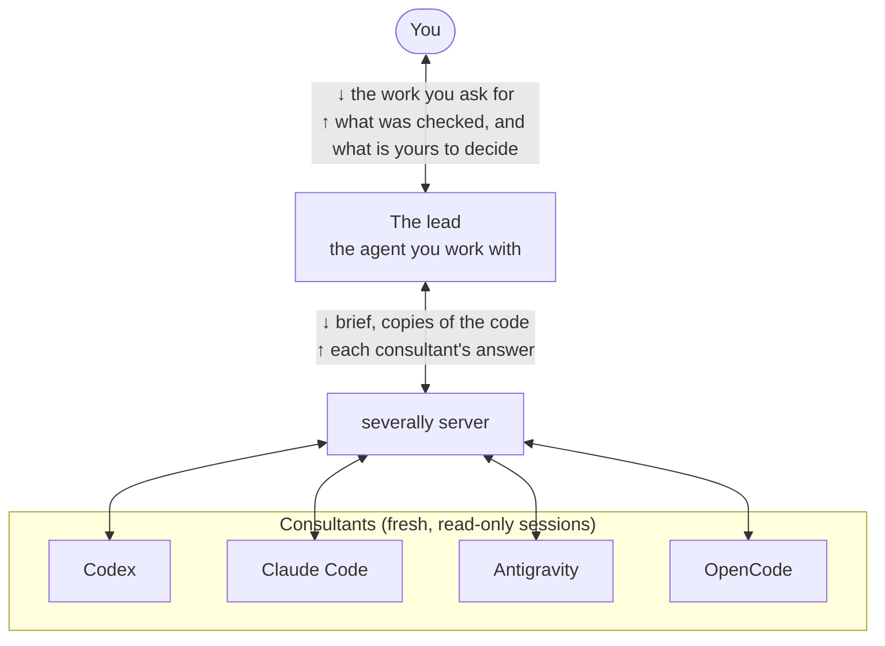

# How severally works: the details

<p>English | <a href="how-it-works.ja.md">日本語</a></p>

What the [README](../README.md) leaves out of how a consultation runs: who consults whom, naming consultants,
how a consultation runs, the records, how large a fan-out's answer is, and how each consultant is kept to
reading. Every configuration key is in [CONFIG.md](../CONFIG.md).

This page includes unreleased sensitive-key masking, redaction observations, recommendations and verification-note
changes. They are not in npm 2.9.2. The [clone installation](install.md#from-a-clone) runs the development source.

## Who consults whom



The lead is the agent you are working with. It writes the *brief*, the question and the facts it rests on, and
consults with read-only copies of the code the question is about. When the answers come back, it checks the
findings itself and asks you only what is yours to decide. In a routine consultation the lead does three things:
starts it, waits for the answers, and records the one finding it checked.

Each consultant is a new session of its CLI, started just for this question. It does not automatically inherit
your conversation history. The server sends the brief, including anything the lead puts in it, and explicitly exposed files.
Depending on the CLI, the consultant can also read other files on disk. The severally server sends every consultant the same brief and
returns the answers consultant by consultant. It does not merge them or judge which is right.

What a consultant can read and do is under [What a consultant can see and do](../README.md#what-a-consultant-can-see-and-do).


From any of the clients, you can consult the other three CLIs and a fresh session of your own. These are the
commands the server starts. By default up to nine consultants run at once, across all your sessions.

```text
Claude Code ──(skill)──> severally server ──> codex exec | agy | opencode run | claude -p  (fresh session)
Codex       ──(skill)──> severally server ──> claude -p  | agy | opencode run | codex exec (fresh session)
Antigravity ──(skill)──> severally server ──> codex exec | claude -p | opencode run | agy  (fresh session)
OpenCode    ──(skill)──> severally server ──> codex exec | claude -p | agy | opencode run (fresh session)
```


## Naming a consultant

- A consultant is one CLI running one model, so a CLI's name ("ask Codex", "ask Gemini") works, and so does a
  model's ("ask Claude Opus", "ask DeepSeek").
- Several can share a CLI, such as GLM and DeepSeek both on OpenCode, if the operator sets them up
  ([CONFIG.md](../CONFIG.md)). Through OpenCode that includes a local model behind an OpenAI-compatible server
  (ollama, LM Studio, vLLM) and models hosted on OpenRouter (checked with Qwen and Kimi).
- When a name fits more than one, the higher tier or newer version is asked. If nothing separates them, the lead
  asks you which one you meant.
- Asking everyone costs one consultation's quota per consultant: four with the default setup, one per CLI. The
  lead may ask fewer when the question is small.
- An answer from your own CLI, whichever model ran it, carries a "same lineage" note so you can tell it apart
  from the other vendors' answers.

## How a consultation runs

A self-contained `question` can start an `explore` consultation. Separate `context.facts` is optional;
there is no need to repeat the question's premises there. Code questions still need files or a diff.
`review` still needs a proposal, and `debate` needs both a proposal and counterpoints.

- While a consultation runs, the lead does not go ahead with the plan in question.
- A transient failure (`rate_limited`, `cli_error`) is run again up to twice, after a short wait and inside the
  same time budget, with the same consultant and model; the earlier failures are listed under `retries`.
- A consultant whose model has used up its account quota (`usage_limit`) is run again once on its `fallback_model`,
  if the config names one. The answer says that the fallback gave it, and `model` shows the one that answered.
- A consultant that runs out of time leaves the end of what it had written beside the failure, marked partial:
  something to read, not an answer.
- A consultation stays readable after the server restarts, and from any other severally process on the machine.
  One still running elsewhere reads as running; one whose server stopped abruptly (a crash or a kill) before it
  finished comes back as `interrupted`; an ordinary shutdown records its running consultations as cancelled.
- `consult_cancel` from another severally process leaves a request for the process running the consultation,
  which checks once a second and stops it.
- A check the lead cannot run itself, such as one that needs another person's answer, comes back to you with the
  reason.
- **For decisions you will have to justify later** (interfaces, migrations, security, concurrency), the lead
  takes extra steps, on its own or when you ask: it pins down the question and success criteria, separates
  imposed constraints from its own assumptions, and writes down what it expects the consultants to say, so the
  record shows later where they surprised it. It puts the record as a Markdown file in your repository, next to
  the code or wherever the repository keeps decision records. The file is an ordinary change you review like any
  other.
- A request with no plan is `explore`, one with a plan is `review`, and one with a plan and the opposing claims
  is `debate`. The server refuses a first `explore` request that contains the plan. A follow-up keeps the mode of
  the consultation it continues, and everything else it was given unless the lead passes it again: the
  consultant, `network`, the objective, constraints, success criteria, facts, plan, opposing claims and supplied
  material. The new brief restates them. The follow-up limit is `server.max_rounds` in the config file.

A follow-up starts a fresh CLI session, with a brief assembled from the saved question, answer and checks;
it does not resume the CLI's native session. When a premise changes, identify the updated premise, advice kept
or withdrawn, specific changes to make and checks to run.

## Records

`limits.network` reports the server default. A job's `network` and `boundary.network` describe that round;
for example, a request with `network: "off"` can run without browsing while `limits.network` still says `"on"`.
The displayed setting alone does not prove an attempted operation was refused.
On Windows, cancellation kills the process tree while the parent is alive. If the parent has already exited,
its PID is not reused for cancellation, because that could kill an unrelated process; descendants can remain.
A test (`test/windows.test.mjs`) cancels a run whose parent has exited and reports in the CI log whether the
descendant remained; the outcome is observed, not guaranteed.

- Each round is one file, and each verdict keeps its effect on the decision. The verdicts mean: `confirmed`, it
  held within the recorded scope; `refuted`, it did not hold in that check; `not_applicable`, true in general,
  not in this codebase; `unverifiable`, cannot be settled with what the lead can reach; `unverified`, not checked, with the reason.
- The lead records its verdicts on every consultant of a fan-out in one `consult_record` call (`records`). If any
  job or point id is wrong, nothing is written; a verdict that could not be saved is reported, not dropped.
- A partial check stays `unverified`, with its scope in `note`. `effect` records the impact on adoption or
  the decision, separately from verification. Reproducing a cache-key collision alone does not confirm an
  authentication bypass: record the collision and leave the broader claim unverified until the real auth path is checked.
- A new `consult_record` note is a shareable summary of checked inputs, environment, result and limits.
  The server stores a `followup_note` capped at 400 characters, marks truncation visibly, and sends that summary
  in follow-ups. Legacy notes without a stored `followup_note` stay local until explicitly recorded again.
- The record also keeps which model asked which, and whether you asked for the consultation.
- The list of recent consultations (`consult_list`) adds up, per consultant, the token and cost figures each CLI
  reported in this session (`usage_totals`), automatic re-runs included. A figure a CLI does not report is not
  counted as zero; it is named under `not_reported`. A consultation that was cancelled or timed out reports no
  usage, and `unreported` counts them, so the totals are not read as everything that ran.

The Markdown export starts with a verification summary: consultant, actual model, job/point ID, verdict,
effect and evidence, linked to the full point. It counts points that are unrecorded, unverified or
unverifiable separately from verified points. `confirmed` does not imply adoption. Each full answer and
record remains below; the server does not combine meanings or infer a decision.
Retry exports also name the source failure and job/chain IDs, and append retained earlier failure/context
records once. Missing source records are named. The appendix reflects currently retained records, including
later verdict updates; prior context may have been shortened when sent.

A short report follows the deciding point through the lead's check:

```text
Point: retry amplification (job_… / f1)
Consultant: Codex, gpt-6.1-sol; stance: do_not_proceed
Recommendation: preserve the operation ID before release.
Grounds: the caller can submit the same operation after cancellation.
Lead's check: the cancellation regression test reproduced a second submission.
Decision/effect: hold the release until the caller preserves the operation ID.
Unverified: production load; no load-test environment available.
```

For code questions, select a diff plus relevant callers, tests and configuration by reading imports and call
sites. `expose_paths` adds files outside the diff. Inspect the exposed file count and skipped/deleted entries;
a missing premise remains unknown. If deciding material is missing, select only the needed implementation,
callers, configuration and tests and supplement once. If still missing, state its effect on the decision.
A filename observed in a tool call does not prove the consultant read or
understood all relevant behavior.

## How large a fan-out's answer is

A finished fan-out uses a 19,500-character response budget, including JSON indentation. The response-size
tests cover up to nine consultants at every answer length cap, escaped text and partial failures.
The comparison puts each consultant's actual answering model, stance and concrete `recommendation` side by
side, followed by `decision_changers` and `unknowns`. Matching stances can recommend different options.
`recommendation` is separate from stance; when absent in older history it is `null` (not declared), never inferred
from a summary. The response also includes summary and findings (id, severity, point and grounds).
Findings get more space than the other lists. Text shortened to fit is marked `truncated`, and
`omitted` counts items left out of a list; no finding is ranked or rewritten by the server.

The lead reads grounds already shown whole and checks deciding claims itself. For missing or shortened details,
`consult_get({ job_id, ids: ["f2", "f5"] })` returns those points whole, with their grounds. A consultant's whole
answer is `consult_get({ job_id })`; `consult_get({ group_id, detail: "full" })` adds the brief and the question
whole, within the same budget for the answers. The saved answers keep their complete contents.

## How a consultant is kept to reading

The README's [What a consultant can see and do](../README.md#what-a-consultant-can-see-and-do) has the summary and
the table per CLI. This section has the mechanisms behind it.

The credential paths blocked where the table says blocked are `~/.ssh`, cloud and package-registry keys, other
coding tools' sessions, severally's own history and the other consultants' sandbox homes, and files such as
`.env`, `.npmrc` or `id_rsa` anywhere.

Codex blocks paths, not names: its sandbox cannot express “`.env` anywhere”, so a repository's `.env` is
readable. Credential directories, including the default `~/.codex` and a relocated `CODEX_HOME`, are denied
as a whole when the executable lives elsewhere. If it lives inside a protected root, its containing entry
is exempt and the other entries are a launch-time snapshot; new entries are not covered. New credential
files must not be placed in that exempt executable entry. Existing symlink roots are resolved and registered
once by canonical path, avoiding duplicate Linux sandbox mounts through aliases.

On Linux, a file-level deny can stop holding when the host replaces that file by rename during the run.
Synthetic probes on 2026-10-24 with Codex 0.164.0 reproduced this for a default-home auth file and a readable
new sibling before the default-home change. On 2026-10-26, synthetic probes with the revised adapter on
Linux/Codex 0.164.0 denied existing, replaced and new children under both direct and symlinked default homes
with an external executable, while public-file reads succeeded. An authenticated consultation also completed
(configured and launched: `gpt-6.1-sol`, effort `low`; effective provider model and effort not independently observed).
Individual protected files, including `~/.claude.json`, remain subject to rename replacement. This is a CLI
sandbox limitation, not something `expose_paths` masking fixes.

Further synthetic probes on 2026-10-27 (JST), Linux/Codex 0.164.0, reproduced three remaining gaps:
an individually denied file became readable after rename replacement; a protected root containing the
executable admitted new siblings; and a legacy `jobs/<id>/home` created after launch was readable.
Existing legacy homes were denied, and public-file reads succeeded. Moving the executable outside the
credential root kept replaced and new children of that root denied. Denying the whole root and adding a
read exception for its executable directory also denied the executable in this probe, so that configuration
cannot replace the entry snapshot. Keep the executable outside credential roots and avoid running pre-1.7
severally alongside current consultations. These probes did not call a model or repeat an authenticated
consultation; macOS and Windows remain untested for these cases.

OpenCode denies protected paths in absolute and Location/worktree-relative form. Its `grep` and `glob` are
disabled because they authorize a search pattern rather than checking every returned file. On OpenCode
2.0.24, the built-in read authorization uses lexical paths. To cover aliases, severally now places its own
dependency-free local plugin in the synthetic HOME, using OpenCode's
[pre-execution hooks](https://opencode.ai/v2/docs/build/plugins#tools). Before each `read`, the guard checks
the requested path and its real path against the same protected roots and filenames, rejects paths it cannot
resolve, and passes the canonical path to the CLI. It also resolves the protected roots on each read so a
root created or retargeted after launch remains covered. It supplies both the V1 `server()` and V2 `setup()` hooks;
no user plugins are inherited. The check and the CLI's file open are separate operations: replacement of a
canonical file or ancestor between them remains unprotected.

On Linux/OpenCode 2.0.24, synthetic checks on 2026-10-26 refused direct, relative, symlinked and swapped-alias
reads before any synthetic secret reached the localhost mock provider; a public file was read successfully.
The tests used `network: "off"`, which by itself does not prevent read results from reaching the model.
V1 hook behavior and the generated bundle are unit-tested; actual V1 CLI loading, macOS and Windows enforcement
have not been verified. These guarantees require a CLI that loads the guard plugin.

Protected roots include recognized absolute credential locations from the server environment and
`clis.<cli>.env`: `CODEX_HOME`, `CLAUDE_CONFIG_DIR`, OpenCode under `XDG_CONFIG_HOME`/`XDG_DATA_HOME`,
`GOOGLE_APPLICATION_CREDENTIALS`, and protected subpaths under `HOME` (`USERPROFILE` on Windows).
They also include the actual severally config file, Antigravity's `.gemini` under `SEVERALLY_AGY_CRED_HOME`,
and OpenCode's `.local/share/opencode` under `SEVERALLY_OPENCODE_CRED_HOME`. Existing canonical targets of
configured symlinks are included. Arbitrary paths selected by CLI/plugin flags, relative locations, new
aliases or changes during a run beyond the checks described above are not guaranteed. Use absolute credential paths; keep credentials outside
executable entries, and use a dedicated OS account with no unrelated secrets when these read gaps matter.

`expose_paths` never copies protected files. Credentials are masked in the brief that is sent and in the answers
that come back; a file a consultant opens on its own is read as it is. Other services' credentials in the
server's environment (`AWS_*`, `GITHUB_TOKEN`, `SSH_AUTH_SOCK`, any name ending in `_TOKEN`, `_SECRET` or
`_API_KEY` …) are not passed to a consultant. Of the credentials, it gets its own vendor's keys, what you set in
`clis.<cli>.env`, and for OpenCode the variables that an `{env:NAME}` in `clis.opencode.provider` names.

Masking recognizes case-insensitive credential names such as `api_key`, `password`, `access_token`, and
`client_secret`, including underscore-separated prefixes, and conservatively treats uppercase custom
`*_KEY` names as credentials. In structured objects, the entire value of a recognized property becomes
`[REDACTED]`, even when short, numeric, null, a code reference, an array, or an object. Other objects and
arrays are traversed without changing the input; ordinary names such as `primary_key` and `sort_key` remain.
Text assignments keep their existing minimum lengths and code-reference exceptions, so `password: true`
can remain in textual code while `{ password: true }` is masked as structured data. CamelCase and hyphenated
spellings are not covered generally. Masking is best effort; missing a pattern is still possible, and two
identical markers do not establish that the original values were equal.

`quality.redaction` records observed replacements at the `files`, `brief` and `result` stages: `true` means a
replacement was observed, `false` means none was observed, and `null` means unknown, including older history.
The exposed-file manifest also reports `redacted`; comparison views and Markdown exports retain these observations.
The `files` stage covers copied-file masking and diff preparation; the brief stage observes the rendered text afterward.
For safe counterexamples, compare field presence or removal, types and structure, and reproduce behavior locally.
Do not recover masked secrets or treat matching markers as evidence of equal originals.

For an executable counterexample, separate a public field name from a clearly synthetic sample value.
Literal assignments to credential-like fields can become invalid syntax after masking replaces their values.
For example, run this from the repository root. Evaluate booleans or assertions without printing secret values.

```js
import assert from 'node:assert/strict';
import { redact } from './src/redact.mjs';

const field = 'api_key';
const sample = 'SYNTHETIC_ONLY';
const input = Object.fromEntries([[field, sample]]);
const output = redact(input);
assert.equal(Object.hasOwn(output, field), true);
assert.equal(Object.is(output[field], sample), false);
```

`node scripts/live-check.mjs --target <name> --mode sandbox` asks a consultant to write a file inside and outside
its working directory and to run a command, then checks the disk. On 2026-10-18 none of Codex, Claude Code and
Antigravity wrote anything: Antigravity's hook refused all three attempts, Claude Code had no write or shell tool
to try with, and Codex declined to try, so its permission profile was not exercised by that run.

Antigravity has no flag that limits its tools, so every tool call of the Antigravity consultant passes a hook
that allows reading and the web and refuses everything else, including tools a later release adds. Codex is
launched with its sub-agent tools turned off, which it otherwise enables by default, and with a permission
profile in place of `-s read-only`: the disk read-only, the shell's network off, and the credential paths
unreadable.

Each answer carries a `boundary` record of what that consultant was launched with (what it could read, its shell,
whether it had the web, whether credential paths were blocked) and `tool_calls`, the tools it actually called,
counted from the CLI's own event stream (Claude Code does not stream its tool calls, so it has none). For Codex,
Antigravity and OpenCode, `tool_inputs` adds what those calls were given: the shell commands Codex ran (at most 30,
secrets masked and each cut to 200 characters; never their output) or the paths and patterns the file tools of
Antigravity and OpenCode were given, and how
many of the files handed over a call names. A name in a call is not proof that the file was read, and a file that
is not named was not necessarily skipped. The group view shows only the count (`exposed_files_in_tool_inputs`).

`npm run doctor` checks the boundary against the CLIs installed on your machine. Each consultant is asked to:

- write a file
- run a command that writes one
- read a canary `.env` and a canary under a protected directory, beside a control file it may read
- start a sub-agent

The results are read from outside, never from the consultant's own report: no file appeared, the canaries' words
did not come back while the control's did, and no sub-agent tool shows in `tool_calls`. A missing file or an
unreturned canary shows that nothing got through, not that a try was refused (a consultant may decline to try),
so for Codex the doctor also runs `codex sandbox` with the same profile and checks that reading the protected
canary gives Permission denied. For Claude Code the sub-agent row can only list the tools it was offered. A row
that could not be checked fails the run. It has been run on Linux only so far, and it spends real quota.

When the question is about code in your repository, the lead hands the files over in its first request by naming
absolute paths (`expose_paths`); what is not a file there, such as a test's output or a log, goes in the brief,
and an excerpt in the brief goes alongside the files rather than instead of them. Those files and directories are
copied read-only into the consultant's working directory (under `./workspace`): at most 20 entries, 500 files
and 5 MB in total. A directory inside a git work tree copies only the files git lists, tracked or untracked but
not ignored, so a repository root fits; outside git, `.git` and `node_modules` are skipped. Symlinks are skipped
rather than followed; text files are credential-masked exactly as the
brief is, binary files are copied unchanged. For a change under review the lead can pass `expose_diff` with the
repository's path instead: the diff (against `HEAD`, or a `base` revision) goes in the brief, cut to fit the
brief's budget (20,000 characters at most), and every file it touches, untracked ones included, is copied under
`./workspace/repo/` at its path in the repository. Protected files are left out of both, git runs with external
diff and textconv drivers and fsmonitor switched off, and the repository's location is not sent. The copy is made
once per request, so every consultant in a fan-out reads the same bytes; the history records their SHA-256. The
copy is deleted with the job, and the history keeps only which paths were shown, not the files' contents; the diff
is part of the brief and is kept with it, masked like the rest. For that consultation the Claude Code consultant
reads only the copy; the other three can still read the rest of the disk. A follow-up starts in a fresh working
directory, and what the earlier round exposed is copied into it again as it is now, with any paths the lead adds:
each entry is marked changed or unchanged by its SHA-256, a directory is listed afresh (so files added since go
too), a path that no longer exists is left out and named, and an earlier `expose_diff` brings back the files it
touched rather than a new diff. The lead passes `expose_from_parent: false` to send none of them. When the
consultant's name now points at another CLI or model, nothing is copied again unless the lead passes `true`.

A follow-up to a fan-out (`followup_to` its `group_id`) asks every member the same new question, each continuing
its own chain from its latest answered round, so each brief carries that consultant's own earlier rounds. A member
that is still running, never answered or has used its rounds is not asked, and the `consult_start` response lists it under `skipped` with the reason.

## Example

Here is how severally changes the way the agent works, shown in one situation: the agent comes up with a change,
and before asking you to approve it, it asks the consultants for their opinions.

The example is a small online shop's API. `GET /products/:id`, which serves the product page, is slow: about
800 ms. The API loads each product joined with its inventory and its reviews. Prices depend on the member's tier,
and gold members get a 10% discount.

The agent, running in Claude Code, comes up with a common fix: "keep each response in an in-memory Map for 5
minutes". Before asking you "can I go ahead?", it shows the plan to three consultants: Codex, Antigravity, and a
fresh Claude Code session (a new session of the agent's own CLI, with none of its conversation). Along with the
plan, it hands them read-only copies of the code involved. The answers come back one per consultant, side by side
(excerpt from a real run against a sample API):

```text
codex        do_not_proceed  the price depends on the member's tier, so keyed by product id alone, the first
                             visitor's price is served to everyone; the join inflates stock; 4 workers keep
                             separate copies, so an order that changes stock does not clear the old value
claude-code  do_not_proceed  whoever fills the cache first sets the price everyone else sees for 5 minutes;
                             4 workers each keep their own copy, so stock stays stale after orders; fix the
                             join bug first too
antigravity  alternative     member discounts leak to other users; the 800 ms comes from joining inventory
                             and reviews, which also skews stock; rewrite the query and it is likely fast
                             enough without a cache
```

Each answer opens with a bottom line: `proceed`, `do_not_proceed`, `alternative` (do something else instead) or
`undetermined`. The three found the same problems, each on its own: the price leak, the inflated stock and the
per-worker caches. Where they differ is what comes next. Codex and Claude Code recommend fixing the query and
then caching only the part that does not depend on the user. Antigravity says that with the query fixed, a cache
may not be needed at all. Merge the answers into one and that difference gets buried.

The agent that asked (the *lead*) reads the findings and then checks them in its own repository. Of the two
findings, one reproduced exactly; the other turned out not to be happening yet, and that changed the response.

```text
finding   the query joins inventory and reviews together, so stock is multiplied by the number of reviews
  checked   ran the query on a test database: 5 units in stock, 4 reviews -> stock comes out as 20
  so        fix the query before any cache

finding   a gold member's 10% discount would be served to guests
  checked   login is not wired in yet, so today everyone gets the base price.
            the leak starts the day login is added
  so        cache only the product data that does not depend on the user, and compute the price on each request
```

What comes back to you is not a vote of "2 against, 1 alternative". It is what was checked, what the lead
recommends, and what has not been checked yet. Here that is whether the fixed query is fast enough without a
cache (it needs production-like data), and how stale the stock shown after an order may be (that one is yours to
decide). You make the call. The checked results stay next to the findings and can be exported as Markdown into
your repository (see [History and records](../README.md#follow-ups-and-history)).

## Recommended setup

Register the strongest model of each vendor as a consultant, and do the everyday work on a cheaper model, such as
Sonnet in Claude Code. Most of the work, such as editing code, running tests and searching, goes fine on the
cheaper model. For the decisions where a wrong call costs the most, such as a design choice or a change that is
hard to reverse, the lead asks the strongest models, each on its own. They spend quota only in those
consultations, so most of the usage stays on the cheaper model, and the decisions that matter still get the
strongest models' opinions.

A `~/.severally/config.json` for this:

```json
{
  "consultants": {
    "opus": { "cli": "claude-code", "model": "claude-opus-5-5" },
    "gpt": { "cli": "codex", "model": "gpt-6.1-sol" },
    "gemini": { "cli": "antigravity", "model": "gemini-4-argon-high" }
  }
}
```

Model ids change as new models come out; replace them with the ones your CLIs offer. Consultants run at effort
`high` unless you set `effort`, except on Antigravity, where the model name sets it (`gemini-4-argon-high`) and an
`effort` key is a config mistake.

Then start the lead on the cheaper model (`claude --model sonnet`, or `/model sonnet` in a running session). The
lead consults on its own at the moments listed under [Asking](../README.md#asking), and you can ask it to ("ask everyone before
we merge this"). Each consultant runs on its own CLI's login and quota.

## API arguments

The arguments of `consult_start` that matter most:

- `context.expose_paths`: files and directories, by absolute path, copied read-only for the consultant; a
  directory in a git repository copies only the files git lists (nothing `.gitignore` excludes)
- `context.expose_diff`: `{ repo, base? }`, a change in progress: the diff goes in the brief and the files it touches are copied
- `network`: `"off"` takes web search and browsing away from every consultant in the round
- `followup_to`: the `job_id` of the answer a follow-up continues, or a fan-out's `group_id` to ask every consultant in it again. A follow-up needs only this and `question`; the consultant, the mode and the earlier round's context carry over unless you pass them again
- `retry_of`: pass only a failed job ID to replay its saved question, context and network in a new chain.
  No other fields are accepted. Successful siblings are not called, and old records stay intact. Files refresh,
  but a saved diff excerpt stays as originally sent; inspect changed/deleted material. Start a new explicit
  consultation to change the question or materials. Remedy auth/quota causes first. A changed primary model/CLI,
  or a failed attempt that ran a configured fallback, is refused rather than silently swapping models.

`consult_list` filters history by `target`, case-insensitive question substring (`question`) and `chain_id`,
before applying `limit`. Each row supplies `latest_completed_job_id` for its chain and `rounds_remaining`,
including later failed rounds already spent. Check candidate content before continuing an ambiguous exchange.
